# long_transients

## The filtering pipeline at a glance

```mermaid
flowchart TD
    IN["<b>Input</b><br/>one row per object: ZTF detections in g, r, i (DAOPhot + our Kron photometry)<br/>+ the matched PS1 stack object, or a PS1-only object"]
    Q["<b>1 · Quality</b> — per band, per survey<br/>is the data here usable?<br/><i>usable, or X</i>"]
    D["<b>2 · Detection</b> — per band, per usable side<br/>what does the survey have?<br/><i>D measured at S/N ≥ 5 · L measured below · U nothing: its limit stands in</i>"]
    S["<b>3 · Comparison and sorting</b><br/>per band: (D, D) two-sided · (D, L/U) ZTF vs PS1 limit · (L/U, D) PS1 vs ZTF limit · an X or (L/U, L/U): nothing<br/>per object: ≥ 2 bands of one kind → <b>in_both</b> / <b>in_ztf</b> / <b>in_pstarr</b>, else not comparable (with the reason)"]
    CONF["<b>4 · Confident</b> — is it one real object?<br/>sharpness (point sources)<br/>in_ztf, in_pstarr: no object within 3″<br/>in_pstarr: PS1 nStackDetections ≥ 2<br/>in_both, in_pstarr: not BAD_STACK, not SUSPECT_STACK<br/>in_ztf, in_pstarr: the detecting survey's light not diffuse, (PSF − Kron − 0.5)/σ ≤ 3 in ≥ 2 bands"]
    POP["<b>5 · Population</b> — not Galactic<br/>no Gaia proper motion or parallax at 5σ"]
    CAL["<b>6 · Calibrate</b> on what is left<br/>each survey's 75 % point-source recovery limit per band (ZTF from the reference image's depth and noise ratio, PS1 from its injection-recovery test of the stack) · the Δmag envelope from the two-sided bands, one per morphology (PSF Δmag for point sources, Kron Δmag for extended objects)"]
    INT["<b>7 · Interesting</b><br/>σ from the envelope: either sign for in_both, ZTF brighter only for in_ztf, PS1 brighter only for in_pstarr<br/>|σ| > 3 in ≥ 2 bands, ≥ 2 of them the same sign"]
    OUT["<b>candidates</b>: in_both · in_ztf · in_pstarr"]
    IN --> Q --> D --> S --> CONF --> POP --> CAL --> INT --> OUT
```



Every band of every object ends step 3 with one of these on each survey's side:

| status | meaning |
|---|---|
| X | a quality check failed: this survey's side of the band is unusable, so the band compares nothing |
| D | measured at S/N ≥ 5 |
| L | measured below S/N 5: used if brighter than the survey's limit, else the limit stands in |
| U | nothing measured: the survey's completeness limit stands in |

The quality checks (step 1), each answering "is the data at this position sound?" and nothing about the object:

| ZTF side | PS1 side |
|---|---|
| outside every Gaia G < 16 star's mask: its circle and four spike boxes | not one of MAST's mis-registered polar skycells (with or without a PS1 object) |
| the reference image covers the position | |
| | the DR2 catalog covers the position: not in one of MAST's missing-data boxes, Dec > −30 (without a PS1 object) |
| | PS1 measured some object in the band within 1′ (without a PS1 object: its stack reaches the position) |
| | the band's deep stack recovers 75 % of injected sources at some magnitude (without a PS1 detection in the band; no stack, or one that never reaches 90 %: partly exposed on the survey edge or crowded in the Galactic plane) |
| DAOPhot flags = 0 | stack nFrames ≥ 4 |
| DAOPhot chi ≤ 6 (detections, point or extended: the PSF fit did not fail) | |
| > 5 px from a masked pixel (at the detection, or at the PS1 position for a limit) | residual sky ≤ 1e-7 |
| extended objects: Kron aperture ≤ 10 % masked | not DEFECT, PEAK_ON_SPIKE, ON_SPIKE, ON_STARCORE, ON_BURNTOOL, SATSTAR, SATSTAR_PROFILE |
| extended objects: a Kron magnitude where the PSF S/N ≥ 5 (the photometry they are judged by; fainter without one: sub-threshold, the limit stands in) | extended objects: likewise |
| | measured in the band (a PS1 object with no row for the band tells us nothing) |
| | psfQfPerfect > 0.85 |
| | psfChiSq ≤ 36 (PSF-fit reduced χ²; the ZTF chi ≤ 6 cut squared) |
| | a stack row from the object's primary skycell (infoFlag3 STACK_PRIMARY; not seen only in a neighbour's overlap) |

Code: `Source_Analysis/filter_field.py` (`usable_sides`, `detection_status`, `COMPARISON`, `object_catalog`, `real_checks`, `completeness_limits`, `kde_envelopes`,
`judge_bands`); every object's record of what happened to it is in `objects.parquet` (`{b}_dropped_by`, `outcome`; `python -m Source_Analysis.filter_field explain FIELD RA DEC`).
Every column of the field tables and the object table, native or ours: `docs/object_columns.md`.
Walkthrough with field 860: `Notebooks/pipeline_review_860.ipynb`.

## Workflow Overview
### 1. Extract
This step extracts sources from ZTF deep stack reference images and the Pan-STARRS source catalog, and stores them.
- Run `run_extraction.py` with the option of the bash script `run_extraction.sh`.
- Ensure that directories populate into the `path/to/Data/catalog_results/field_results` directory with names like `<field_id>_<ccd_id>_<q_id>` (e.g. `000245_15_4`) that contain the following files:
    - EPSFs/
        - ZTF_g_EPSF.npy
        - ZTF_r_EPSF.npy
        - ZTF_i_EPSF.npy
    - nan_masks/
        - ZTF_g_nan_mask.npy
        - ZTF_r_nan_mask.npy
        - ZTF_i_nan_mask.npy 
    - WCSs/
        - ZTF_g_wcs.pkl
        - ZTF_r_wcs.pkl
        - ZTF_i_wcs.pkl
    - PSTARR.ecsv
    - ZTF_g.ecsv  
    - ZTF_r.ecsv
    - ZTF_i.ecsv


### 2. Match sources between ZTF and Pan-STARRS
This step will associate the sources stored in the ZTF and Pan-STARRS `.ecsv` files that were stored in step 1.
- Run `cross_match.py -aq -mf` with the option of the bash script `cross_match.sh`.
    - If you don't want to associate quadrants and merge fields, consider removing the kwargs.
- Ensure that files populate into the `path/to/Data/catalog_results/field_results` directory with names like `<field_id>_<band>.ecsv`. Note that you'll also find files like `<band>_associated.ecsv` in the `<field_id>_<ccd_id>_<q_id>` directories created in step 1.
It is important to realize that sources may have non-detections in Pan-STARRS or ZTF!

### 3. Filter sources
This step takes the sources and passes them through filtration pipelines. You'll just need to look at the `filter_fields.py` file.
- Run `filter_fields.py` with the option of the bash script `filter_fields.sh`.
- Ensure that directories labeled by fieldid (e.g. `000313`) populate into the `filter_results/` directory with files `0.ecsv`, `1.ecsv`, and `2.ecsv` corresponding to in_both, in_ztf, and in_pstarr.

### 4. Combine filtration results into one table
This step takes the filtration results and combines them into a single table.
- Run `combined_filtered_tabs.py` with the option of the bash script `combined_filtered_tabs.sh`.
- Ensure that a new folder `combined/` appears in the `filter_results/` directory with files `0.ecsv`, `1.ecsv`, and `2.ecsv` and the corresponding flowcharts and stats. These files have all the candidates for each of the three catalogs!

### 5. Make (and sort) analysis pages
Make analysis pages for each source by running `store_src_plots.py` which does something like:
```
import matplotlib.pyplot as plt
from Source_Analysis.Sources import Sources

coords = Sources.from_file('path/to/file.ecsv')
for c in coords:
    c.plot_everything()
    plt.show()
```
